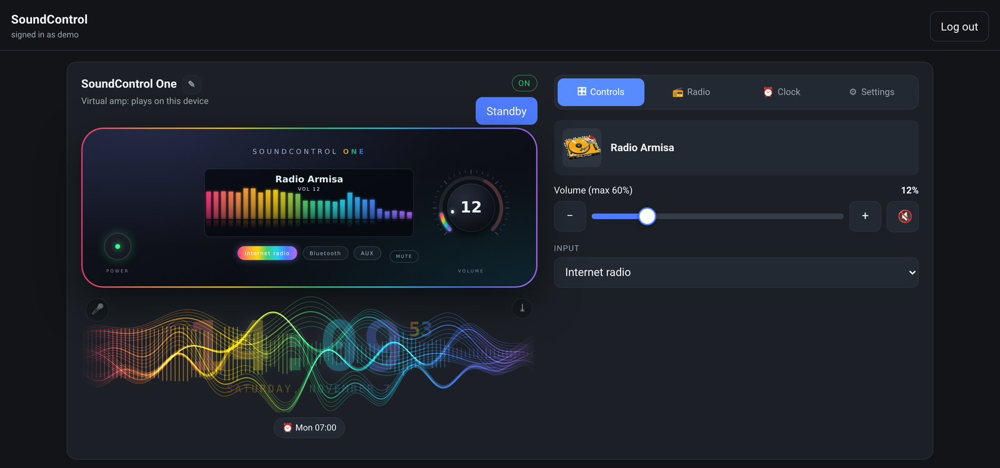
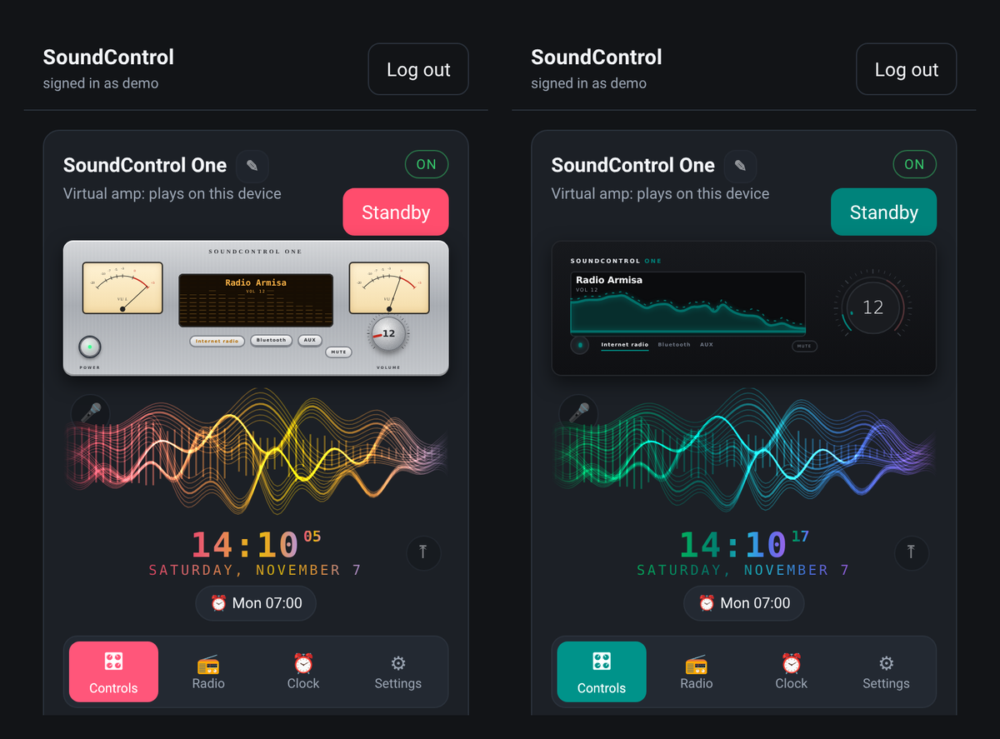

# SoundControl

A self-hosted web remote for network amplifiers on your home network. Sign in
from a phone or PC and control the amp without hunting for the IR remote.

Built for and tested on a **Marantz PM7000N** (HEOS + the Marantz/Denon network
control protocol). Also includes **experimental** drivers for **Yamaha MusicCast**,
**Onkyo / Pioneer / Integra** and **Bluesound / NAD (BluOS)**, written from their
published protocols and tested against fake devices: see `docs/DRIVERS.md`. The design is device-agnostic: one driver per protocol,
devices added by configuration.

**No amp? No problem.** Without a device config the app starts with a
**virtual amp**: pick a digital front panel, play thousands of internet radio
stations right on your phone or PC, and watch the visualiser and meters move to
the real music.



<p align="center"></p>

<sub>Screenshots: the virtual amp with the built-in digital faces (no hardware needed).</sub>

> Not affiliated with or endorsed by Marantz, Denon, HEOS or TuneIn. Product
> names are used only to say what this works with.

## Features

- **Power, volume, mute and input**, with a per-device volume cap enforced on
  the server (default 40%), so a slip cannot blast the room.
- **Digital front panels**: three original skins drawn in code (Neon glass,
  Retro VU with swinging needles, Minimal pro), with a draggable volume dial
  and meters that follow the music. Pick one in Settings.
- **Browser radio** (virtual amp): browse genres or search the open
  [Radio Browser](https://www.radio-browser.info) directory and play in the
  page. The server passes the stream through so the visualiser can analyse the
  real audio; it only streams stations from the directory and refuses any
  private or local network address.
- **Speakers**: tap the side tabs to slide a pair of bookshelf speakers out
  beside the amp; tap one to take its grille off. The cones punch out on the
  beat and the tweeters flick on cymbals, more as the volume goes up.
- **Add devices from the app**: Settings → 🔌 Devices (admins). Type an IP and
  press Detect: SoundControl asks the device who it is (read-only) and suggests
  the setup. Or scan a home network (/24) to find amps; note that security
  tools may report a scan as a port scan. Works where multicast discovery
  cannot (e.g. WSL in NAT mode). Only private addresses can be probed.
- **Name it yourself**: tap ✎ to rename a device and its room line.
- **Update notices and one-click updates**: the app checks GitHub for newer
  releases (public data only; `UPDATE_CHECK=off` disables it) and shows a ⬆
  marker, an admin banner and Help → Updating. Admins of git installs can press
  **Update now**: it backs up settings, accepts only **release tags signed with
  the trusted release key** (`release/allowed_signers`, read from the installed
  version), installs, runs the tests, restarts, and rolls back automatically if
  anything fails. `UPDATE_INSTALL=off` hides the button. Maintainers: see
  [docs/RELEASING.md](docs/RELEASING.md).
- **Help built in**: the ? Help button (or press ? / F1) opens a searchable
  guide to every feature, troubleshooting and privacy notes, plus What's new.
  Release history: [CHANGELOG.md](CHANGELOG.md).
- **Interactive front panel** (optional, needs photos, see below): turn the
  real volume knob, click through inputs with the input knob, press power and
  Source Direct, and read the live state on the amp's own display.
- **Clickable handset** (optional): the RC004PM remote beside the amp, every
  button wired to its real job. Buttons the amp can confirm report what
  happened; menu keys the amp cannot confirm say so.
- **Internet radio**: browse and search TuneIn through HEOS (local radio,
  genres, news, sports, podcasts), with station logos and one-tap play.
- **Spotify** (Premium): paste a playlist, album or track link, or pick one of
  your playlists, and play it on any Spotify Connect speaker such as the amp.
  Bring your own free Client ID from developer.spotify.com (Settings → Spotify
  shows the steps). Sign-in uses PKCE: no client secret or Spotify password is
  stored, and tokens never leave the server (`data/spotify.json`).
- **HEOS account**: sign the amp in from the app to unlock radio and favourites.
  The password goes straight to the amp and is never stored by this app.
- **Sound visualiser**: animated waves that follow the amp's state, or listen
  through the microphone (🎤) and react to the real sound in the room.
  Analysed in the browser only; nothing is recorded or sent anywhere.
- **Ghost clock, alarms, timers and reminders**: a translucent digital clock
  floats over the visualiser in its colours. Alarms run on the server, so they
  work with no browser open, and can wake you to a radio station or an input,
  fading up to a chosen volume (never above the cap). Timers can put the amp in
  standby when done; reminders chime and can show desktop notifications.
- **Theme**: the app's accent colour can follow the visualiser palette.
- **Sleep timer, random, repeat, favourites 1–9, Source Direct.**
- Tabs on phones, a three-column layout on wide screens, dark theme throughout.

## Security

- Local accounts only, bcrypt (cost 12), no default accounts: the first user
  is created from the command line.
- HTTP-only, `SameSite=Lax` sessions, regenerated at login; CSRF token on every
  state-changing request; 5 failed logins lock the username+IP for 15 minutes.
- Strict Content Security Policy (no inline scripts).
- The browser never sends amp commands: it names a button or an action, and the
  server maps it from a fixed list. Values passed back to the amp (radio station
  and folder IDs) are validated so they cannot add parameters or commands.
- The API never returns device addresses or credentials.
- **HTTPS built in**: `npm run cert` creates a local certificate authority and
  a certificate; with `TLS_CERT`/`TLS_KEY` set, the app serves HTTPS
  (`HTTPS_PORT`, default 8443), plain HTTP only redirects, cookies are Secure
  and HSTS is on. Trust `data/tls/ca.crt` once per device: **[docs/HTTPS.md](docs/HTTPS.md)**
  walks through creating the certificate and trusting it on Windows, macOS,
  Linux, iPhone/iPad, Android and Firefox.
- **Roles**: admins manage account-level settings (Spotify, HEOS account,
  names); regular users (`npm run user:create -- NAME --user`) control the amp,
  radio and clock.
- Commands sent to the amp are single-line only (no injected extra commands),
  and error messages never contain device addresses.
- **Run it on your home network only and never expose the port to the
  internet.** The amp's own protocols are unencrypted, so the server-to-amp
  link (including the HEOS sign-in) stays plain on your LAN.

## Requirements

- Node.js 20 or newer
- The server can reach the amp on TCP **1255** (HEOS) and TCP **23** (network
  control)
- On the amp: **Network Control = Always On** (otherwise it disappears in
  standby)

## Install and run

```bash
git clone https://github.com/jestie/AmpControl.git
cd AmpControl
npm install

cp .env.example .env
# put a real secret in .env (32+ random characters):
node -e "console.log(require('crypto').randomBytes(32).toString('hex'))"

# Have a network amp? Configure it (skip this for the virtual amp):
cp config/devices.json.example config/devices.json
# edit config/devices.json: set your amp's IP address

npm run user:create        # first account (admin); the password is not echoed
npm run cert               # recommended: your own local HTTPS certificate (see docs/HTTPS.md)
# then add to .env: TLS_CERT=./data/tls/server.crt TLS_KEY=./data/tls/server.key HTTPS_PORT=8443
# and trust data/tls/ca.crt on your devices (step-by-step for each OS in docs/HTTPS.md)
npm test                   # no hardware needed
npm start
```

Open `https://<server-ip>:8443` (or `http://<server-ip>:8095` without a certificate) from any device on the same network. The app
binds `0.0.0.0` by default; set `HOST` to restrict it.

### Front panel and remote photos

The interactive front panel and handset are drawn over photos of the amp and
its remote. Those are the manufacturer's images, so they are **not included**.
Without them the app works with its standard controls. See
[`public/img/README.md`](public/img/README.md) for the file names and sizes to
add your own.

### Run it in the background (systemd user unit)

```ini
# ~/.config/systemd/user/soundcontrol.service
[Unit]
Description=SoundControl
After=network-online.target

[Service]
WorkingDirectory=%h/AmpControl
ExecStart=/usr/bin/env node src/server.js
Restart=on-failure
RestartSec=3

[Install]
WantedBy=default.target
```

```bash
systemctl --user daemon-reload
systemctl --user enable --now soundcontrol
```

## Devices

Edit `config/devices.json` (schema in [`docs/DRIVERS.md`](docs/DRIVERS.md)).

| Driver | Protocol | Typically provides |
|---|---|---|
| `heos` | HEOS CLI, TCP 1255 | playback, now playing, radio, favourites, HEOS account, transport |
| `denon_avr` / `marantz` | Marantz/Denon network control, TCP 23 | power, volume, mute, inputs, Source Direct, sleep timer, menu keys |
| `yamaha` *(experimental)* | Yamaha MusicCast (YXC, HTTP 80) | power, volume, mute, inputs, transport, now playing, presets |
| `onkyo` / `pioneer` / `integra` *(experimental)* | eISCP, TCP 60128 | power, volume, mute, inputs, transport, now playing |
| `bluos` / `bluesound` / `nad` *(experimental)* | BluOS HTTP, port 11000 | volume, mute, transport, now playing, presets, stream URLs |
| `virtual` | none | a virtual amp for browser radio: power, volume, mute, inputs |
| `unsupported` | none | an honest "no network control" placeholder |

A device lists the drivers it needs; their capabilities are merged and the UI
only shows what the device can do.

### Notes from testing on a PM7000N

- App volume percent equals the amp's raw `MV` value (0–100).
- Only inputs enabled in the amp's own setup are accepted; others are silently
  ignored, so list only those in `denon_avr.inputs`. The handset tries other
  sources and tells you if the amp ignored them.
- Bass, treble and balance are analogue front-panel knobs: there is no network
  command for them. Source Direct (bypassing them) can be toggled.
- The sleep timer accepts 10–90 minutes in steps of 10. A command sent right
  after another can be dropped, so the app reads it back and retries.
- Menu keys (arrows, Enter, Back, Setup, Option, Info) and the dimmer get no
  reply from the amp, so their effect cannot be confirmed by the app.
- Internet radio, presets and favourites need the amp signed in to a HEOS
  account. Accounts are created in the HEOS app.

## Troubleshooting

| Symptom | Check |
|---|---|
| Card says Offline | `nc -vz <amp> 1255` and `nc -vz <amp> 23` from the server; firewall rules between the server and the amp |
| Amp vanishes in standby | **Network Control = Always On** on the amp |
| Volume stops at 40% | That is the device's `volumeCap` in `config/devices.json` |
| 403 on every action | The page was open across a server restart: reload and sign in |
| An input does nothing | It is switched off in the amp's setup; enable it there first |
| Radio tab says to sign in | Sign the amp in to HEOS in the Settings tab |
| 🎤 says it needs HTTPS | Browsers only allow the microphone over HTTPS (or on localhost) |

Logs: `logs/activity.log` (who did what, when) and `logs/error.log`.

## Tests

```bash
npm test
```

Covers volume capping, driver routing and fallback, password hashing and login
lockout, CSRF, HEOS sign-in (password escaping, never leaked in errors), radio
command safety, Source Direct read-back, the handset's button rules, alarms
(days, once-only, capped fade-up) with a fake clock, and an
HTTP round trip with a fake device. No hardware or network needed.

## Layout

```
src/app.js          express app (auth, sessions, CSP, views)
src/server.js       startup/shutdown, device init
src/routes/api.js   REST API, capability checks, volume cap
src/remote.js       the handset: button -> action, from a fixed list
src/schedule.js     alarms, timers, reminders (data/schedule.json, not in git)
src/manager.js      loads devices, builds composite drivers
src/drivers/        heos, denon_avr, composite, unsupported
src/auth/           users (bcrypt), csrf, login limiter
public/             app.js, faces.js, webradio.js, faceplate.js, handset.js,
                    visualizer.js, clock.js, app.css
src/webradio.js     Radio Browser search + safe stream pass-through
src/spotify.js      Spotify sign-in (PKCE) and playback via the Web API
src/discovery.js    detect amps by IP (read-only queries) and scan a home /24
views/              login + app shell
tests/              node:test suite
config/             devices.json.example
```

## License

[MIT](LICENSE)
